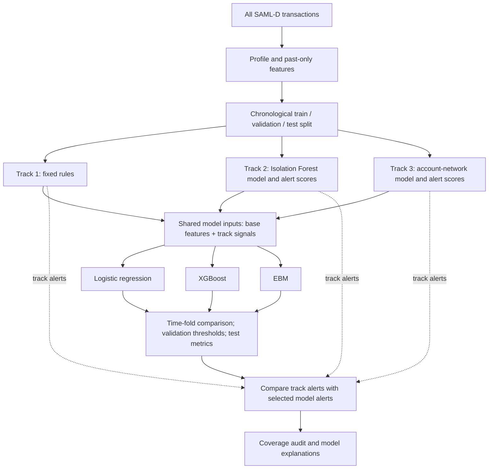

# Guide to the SAML-D AML notebook

The [notebook](../aml_modeling.ipynb) holds every code cell, saved table, chart, and model explanation for this class MVP. The [README](../README.md) covers setup and data download. The [class report](CLASS_REPORT.md) presents the findings and limitations.

## Question and scope

Can simple detection signals and understandable classifiers prioritize synthetic transactions labeled as laundering for review? We compare three parallel detection tracks and three final classifiers. This is **transaction-level** analysis of a synthetic dataset. An alert is not an investigator finding or a Suspicious Activity Report.

The local SAML-D CSV has **9,504,852 transactions** from October 7, 2022 through August 23, 2023. **9,873 (0.1039%)** have `Is_laundering = 1`. The seven payment methods have different positive-label rates; Cash Deposit has 0.6239% and ACH has 0.0577%. The notebook profiles label balance, payment types, monthly rates, and amounts within one currency. These are properties of the generator, not measured bank risk.

## Architecture at a glance

The project has **three detection tracks** and **three alternative classifiers**. A track produces a simple score or flag. Each classifier then uses those signals alongside the original transaction features. The classifiers do not wait for a track to raise an alert: each scores every validation and test row.

**Two uses of each track:** its signal can help all three classifiers calculate a risk score; its own yes/no alert is measured separately. The **three-track union** is `rule_alert OR anomaly_alert OR network_alert` for each transaction, so overlapping alerts count once. It contains no classifier alerts. A separate comparison adds track alerts to the selected classifier's alerts to show the change in recall and workload. Neither union is a fourth fitted model or the recommended queue.

All of these blocks are sections of the **same [aml_modeling.ipynb](../aml_modeling.ipynb)**. Sections 5–7 are the three tracks; sections 8–16 combine their signals, compare the three classifiers, and explain the results. No intermediate CSV or separate notebook is needed.

| Track | Signal used by all three classifiers | Standalone alert used only in comparison |
| --- | --- | --- |
| Rules | Three individual rule flags | `rule_alert`: any rule fired |
| Anomaly | Original broad `anomaly_score` | `anomaly_alert`: behavior-focused Isolation Forest score above its cutoff |
| Network | Original `network_score`; earlier distinct-counterparty counts are also base inputs | `network_alert`: counterparty novelty score above its cutoff |

The target label is used to **fit the classifiers**, choose their validation alert thresholds, compare candidate track designs on validation, and evaluate test results. The final anomaly and network **cutoffs** are the 99.9th percentiles of validation scores, so the cutoff values themselves do not use labels. The alert-focused track scores are separate from the continuous model features; refining them leaves XGBoost inputs unchanged.

## Notebook order

| Sections | What to read |
| --- | --- |
| 1–4 | Imports, data profile, quick EDA, past-only feature construction, and split. |
| 5 | Three readable transaction rules and their alert volumes. |
| 6 | Label-free Isolation Forest reference, anomaly scores, and alert cutoff. |
| 7 | Earlier distinct counterparties, network score, and alert cutoff. |
| 8–10 | Shared classifier inputs, three simple models, and expanding time-fold comparison. |
| 11–13 | Final fit, validation-selected classifier thresholds, later test results, and track consolidation. |
| 14–16 | Missed-label coverage, separate model scorecards and explanations, conclusion. |

## Time split and leakage control

The split uses complete calendar days in order. About 70% of **days** are for training, 15% validation, and 15% testing. Row shares differ slightly:

| Period | Dates | Rows | Positive labels | Positive rate |
| --- | --- | ---: | ---: | ---: |
| Train | Oct 7, 2022–May 18, 2023 | 6,661,223 | 6,774 | 0.1017% |
| Validation | May 19–Jul 5, 2023 | 1,430,805 | 1,416 | 0.0990% |
| Test | Jul 6–Aug 23, 2023 | 1,412,824 | 1,683 | 0.1191% |

Three expanding time folds fit on earlier training days and evaluate on the next block. Model family is chosen by mean **average precision (AP)** over those folds. All three final classifiers fit on the whole training period. For each classifier, the validation threshold maximizing F1 defines alerts; the test period is used only for evaluation and coverage analysis. We do not shuffle rare positive labels across future and past dates.

`Date` and `Time` set order and derive hour/weekday. `Amount`, currencies, locations, and payment type provide current facts. Account IDs connect earlier activity but are not direct classifier inputs. Earlier sender count, receiver count, pair count, sender same-currency count, sender average amount, and distinct earlier counterparties use transactions strictly **before** the row's timestamp. Same-second transactions do not count one another. `Is_laundering` is the target only. `Laundering_type` is **never a detection or model input**; it identifies generated scenarios for the final missed-label audit.

## Three detection tracks

1. **Rules:** fixed flags for cash deposit into an account with at least 10 earlier distinct senders; cash withdrawal from an established sender with a large change from its earlier typical amount; and a cross-border currency-mismatched new pair from an established sender. These are illustrative thresholds set without labels, not Actimize or Mantas rules.
2. **Anomaly:** two Isolation Forests fit on the first 10% of training days without labels. The original broad score remains a model feature. A second forest uses amount, change from the sender's earlier usual amount, time, and same-location/currency behavior to create standalone alerts. Its score cutoff is the validation 99.9th percentile. This scores unusual behavior, not known laundering. The behavior-focused feature set was selected from simple candidates using validation labels. [Scikit-learn's documentation](https://scikit-learn.org/stable/modules/generated/sklearn.ensemble.IsolationForest.html) defines lower raw scores as more abnormal; we negate them.
3. **Network:** prior counts of distinct sender counterparties and receiver counterparties give fan-out and fan-in. The original maximum-degree score remains a model feature. The standalone alert score is `(log1p(sender distinct receivers) + log1p(receiver distinct senders)) / (1 + log1p(prior pair count))`, favoring distinct relationships over repeated activity in one pair. We compared simple formulas using validation labels, then set the alert cutoff at the unlabeled validation 99.9th percentile. This is one-hop relationship analytics, not a multi-hop graph or cycle detector.

The classifier feature set includes original transaction features, earlier-activity features, the three individual rule flags, the **original** `anomaly_score`, and the **original** `network_score`. The new alert-focused scores are excluded. **Every validation and test transaction is scored by each classifier**, regardless of track alerts; all training rows are used for fitting. The architecture diagram above separates model inputs from the standalone alerts used in the final comparison.

## Three risk-prioritization models

| Model | Shape | Explanation in notebook |
| --- | --- | --- |
| Logistic regression | Weighted sum of scaled numbers and one-hot categories. | Global coefficient and single-row contribution charts. |
| XGBoost | 100 shallow trees, maximum depth 3. | Global and local Tree SHAP in raw-score units. |
| EBM | Additive learned feature effects, interactions off. | InterpretML's native global importance, feature-effect, and local plots. |

Positive training rows get 10 times the weight of negative rows. This is a simple class-imbalance choice, not an estimate of real bank investigation cost. All three models receive the same underlying transaction and track information.

## Read the metrics

- **AP** summarizes ranking across thresholds; the rare positive rate is its approximate random-ranking baseline.
- **Precision** is labeled positives among alerts. **Recall** is labeled positives caught among all labeled positives.
- **F1** balances precision and recall at the chosen threshold.
- **False positive rate** is negative-label rows alerted divided by all negative-label rows. Even a small rate can mean many alerts with millions of rows.
- **Alerts**, **true positives**, **false positives**, and **missed positives** are transaction counts against synthetic labels, not unique customers or investigation cases.

No universal U.S. rule specifies required AML precision, recall, F1, or FPR. Institutions need risk-based coverage, investigation capacity, sound data and labels, independent validation, and ongoing monitoring. The [FFIEC BSA/AML Examination Manual](https://bsaaml.ffiec.gov/manual/AssessingComplianceWithBSARegulatoryRequirements/04) describes monitoring in relation to an institution's risk profile. This notebook does not implement analyst review, case disposition, feedback, vendor systems, or production controls.

For the actual scores and coverage findings, read the [class report](CLASS_REPORT.md). The complete tables and charts remain in the [notebook](../aml_modeling.ipynb); there are no separate result files.
